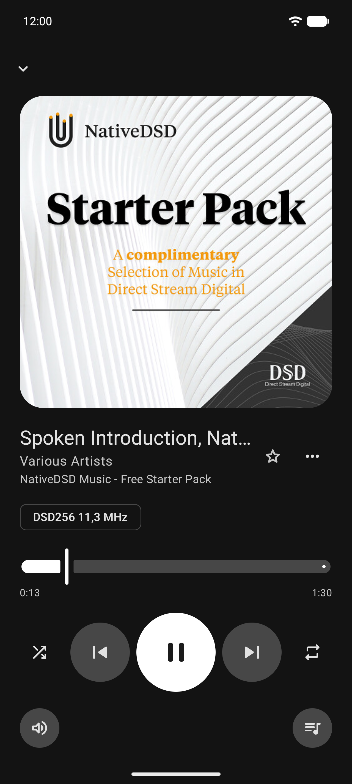
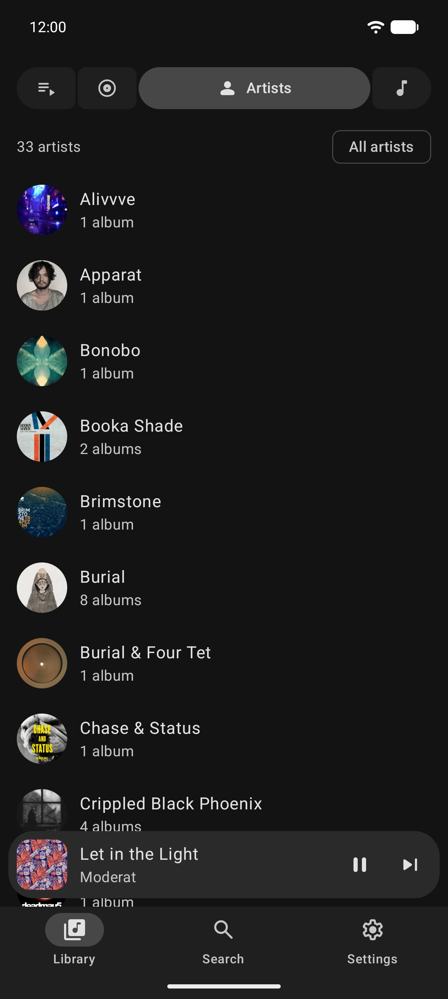

#  Music

A private, offline music player for Android that plays the music you keep on your phone.

**Current version**: v0.1.0

Source code and releases: [git.hnet.sh/hkr/music](https://git.hnet.sh/hkr/music)

## Overview

Music plays the audio files in the folders you choose and nothing else. It has no Internet permission, doesn't ask for access to your storage or media, and keeps nothing about you: the library, playlists and settings stay on the device. It is built for people who keep their own collection – FLAC and hi-res included – and want a player that respects it.

## Screenshots

     

## Features

### Library

- **Your folders only**: Add the folders with your music through Android's folder picker; Music sees nothing else on the phone
- **Albums, artists, tracks and playlists**: Four views in the order you choose, opening on the one you pick or the last one used; albums group by album and album artist, with compilations and multi-disc albums handled
- **Search**: Albums, artists, tracks and playlists at once, ignoring diacritics
- **Scanning**: New and changed files are picked up on every start, or on demand; very short files (sounds, voice notes) can be left out
- **Play counts**: Tracks you listen to at least halfway are counted, for a Most played sort and an artist's most played tracks – a number per track, nothing more

### Playback

- **Formats**: FLAC, ALAC, AAC, MP3, Ogg Vorbis and Opus, with gapless playback; DSD (DSF and DSDIFF) played as PCM
- **ReplayGain**: Track, album or automatic, with a pre-amp for files without tags and clipping prevention
- **Queue**: Reorder, remove with Undo, save as a playlist; shuffle and repeat that the queue shows as they play; the queue is kept across restarts
- **Now playing**: Cover, technical details of the file, seek bar, volume and the track's tags

### Playlists

- **Your own playlists and Starred**, kept in the app
- **Import and export** of M3U, M3U8, PLS and XSPF; tracks that can't be found stay in place and come back when they turn up

### Settings

- **Backup and restore** of settings and playlists to a file you choose, also offered on the first start
- **Language**: English or Polish, independent of the system
- **What's new**, the **license** and the open-source licenses, readable offline

## Requirements

- Android 14 (API level 34) or higher
- Music files in a folder on the device or on an SD card

## Building

```bash
git clone https://git.hnet.sh/hkr/music.git
cd music
./gradlew assembleDebug
```

Set the Android SDK path in `local.properties` (`sdk.dir=…`) first. Unit tests run with `./gradlew test`.

## Tech stack

- **Language**: Kotlin
- **Min SDK**: Android 14 (API 34), **target SDK**: API 37
- **UI**: Jetpack Compose with Material 3 Expressive
- **Playback**: Media3 ExoPlayer with a media session service
- **Data**: Room, DataStore; files through the Storage Access Framework
- **Tags**: Its own parser for FLAC, Ogg, MP3 and MP4 tags

## License

[GPL-3.0](https://www.gnu.org/licenses/gpl-3.0.en.html)

## Acknowledgments

- [Claude](https://claude.ai) by Anthropic – AI assistant that provided valuable support during the development process, helping with code implementation, architecture decisions, and documentation
