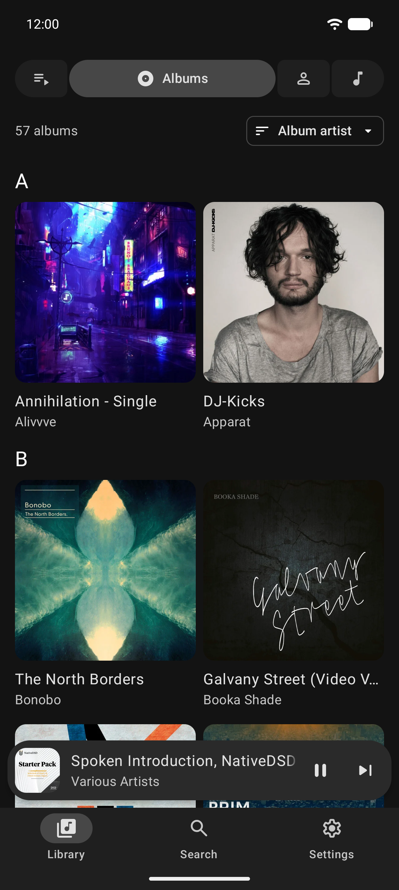
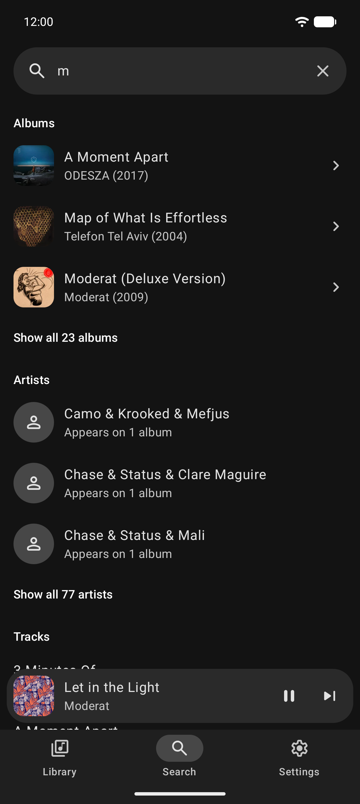
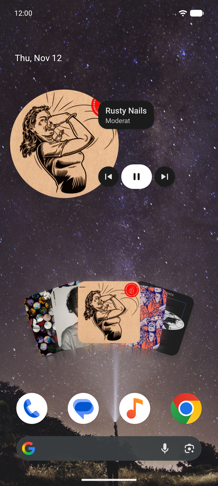

#  Music

A private, offline music player for Android with DSD, bit-perfect USB output and a parametric equalizer.

**Current version**: v0.3.4

Source code and releases: [git.hnet.sh/hkr/music](https://git.hnet.sh/hkr/music)

Bug reports and feature requests: [github.com/legal-hkr/music](https://github.com/legal-hkr/music/issues)

## Overview

Music plays the audio files in the folders you choose and nothing else. It has no Internet permission, doesn’t ask for access to your storage or media, and keeps nothing about you: the library, playlists and settings stay on the device. It is built for people who keep their own collection – FLAC, hi-res and DSD included – and want a player that respects it.

## Screenshots

     

## Features

### Library

- **Your folders only**: Add the folders with your music through Android’s folder picker; Music sees nothing else on the phone
- **Albums, artists, tracks and playlists**: Four views in the order you choose, opening on the one you pick or the last one used; albums group by album and album artist, with compilations and multi-disc albums grouped properly. Albums, artists and tracks have section headers that follow the sort order: letters, years, or this year’s months for Recently added
- **Search**: Albums, artists, tracks and playlists at once, ignoring diacritics
- **Scanning**: New and changed files are picked up on every start, or on demand; very short files (sounds, voice notes) can be left out
- **Covers**: The cover embedded in each file, or else an image named `cover`, `folder`, `front` or `album` (JPEG, PNG or WebP) from the track’s folder, or from the album folder when the discs are in subfolders such as `CD1` or `Disc 2`
- **Play counts**: Tracks you listen to at least halfway are counted, for a Most played sort and an artist’s most played tracks – a number per track, nothing more. Counting can be switched off and the counts reset

### Playback

- **Formats**: FLAC, ALAC, AAC, MP3, Ogg Vorbis and Opus, with gapless playback; DSD (DSF and DSDIFF) converted to PCM, or sent unconverted as DoP over bit-perfect output
- **ReplayGain**: Track, album or automatic, with a pre-amp for files without tags and clipping prevention
- **Equalizer**: Parametric, up to 20 peak and shelf filters with a pre-amp and a response curve; your own presets, built-in ones, and import and export of Equalizer APO text (the format AutoEq publishes)
- **Output devices**: Music remembers the outputs it has played on – the speaker, wired and Bluetooth headphones, USB DACs – and each can have its own equalizer preset, applied when playback switches to it. Bluetooth devices are told apart by name, so no extra permission is needed
- **Bit-perfect output**: With a USB DAC, the audio goes out unchanged at each file’s own sample rate, bypassing the system mixer; switched on for each DAC separately, and the Output page shows what the connected device accepts
- **Sound path**: The output button in the volume bar opens a page that shows the path of the sound: the file, what Music does to it (DSD conversion or DoP, ReplayGain, the equalizer, the volume) and what the device receives, and, when a USB DAC with bit-perfect output on goes through the system mixer, the reason why
- **Queue**: Reorder, remove with Undo, save as a playlist; the queue shows shuffle and repeat as they play and is kept across restarts
- **Now playing**: Cover, technical details of the file, the ReplayGain applied or bit-perfect output, seek bar, volume with the output in use, the equalizer and the track’s tags

### Playlists

- **Your own playlists and Starred**, kept in the app
- **Import and export** of M3U, M3U8, PLS and XSPF; unavailable tracks keep their place and come back when found

### Interface

- **Material 3 Expressive** design with your phone’s colors
- **Home-screen widgets**: Now playing with playback controls, a playlist of your choice to play or shuffle, and the covers of your most played albums; all sit directly on the wallpaper, without a background

### Settings

- **Backup and restore** of settings, playlists, equalizer presets and remembered devices to a file you choose, also offered on the first start
- **Language**: English or Polish, independent of the system language
- **What’s new**, the **license** and the open-source licenses, readable offline

## Requirements

- Android 14 (API level 34) or higher
- Music files in a folder on the device or on an SD card

## Building

```bash
git clone https://git.hnet.sh/hkr/music.git
cd music
./gradlew assembleDebug
```

Set the Android SDK path in `local.properties` (`sdk.dir=…`) first. Unit tests run with `./gradlew test`.

## Contributing

Development happens on [git.hnet.sh](https://git.hnet.sh/hkr/music), where the releases are published too. The [GitHub repository](https://github.com/legal-hkr/music) is a read-only mirror, updated on every push, and the place to report problems:

- **Issues**: Open them on [GitHub](https://github.com/legal-hkr/music/issues), with the app version and your Android version
- **Pull requests**: Welcome on GitHub as well, but they can’t be merged there – accepted changes are applied on git.hnet.sh and reach the mirror from there, so the pull request itself ends up closed rather than merged

## Tech stack

- **Language**: Kotlin
- **Min SDK**: Android 14 (API 34), **target SDK**: API 37
- **UI**: Jetpack Compose with Material 3 Expressive
- **Playback**: Media3 ExoPlayer with a media session service
- **Data**: Room, DataStore; files through the Storage Access Framework
- **Tags**: Its own parser for FLAC, Ogg, MP3, MP4 and DSD tags
- **Widgets**: Classic app widgets (RemoteViews), no extra libraries
- **Audio**: Its own ReplayGain, equalizer and DSD stages in the player’s audio path; bit-perfect output through Android’s preferred mixer attributes

## License

[GPL-3.0](https://www.gnu.org/licenses/gpl-3.0.en.html)

## Acknowledgments

- The built-in Audeze iSine 10 equalizer preset comes from measurements by oratory1990, as published by [Atrium Audio](https://atriumaudio.net/eq/audeze-isine-10)
- [Claude](https://claude.ai) by Anthropic – AI assistant that provided valuable support during the development process, helping with code implementation, architecture decisions, and documentation
